# How Cointrail Pulls Data from Ingest

> A visual walkthrough of how the cointrail frontend talks to the ingest service.
> Read the diagrams — the text is just commentary.

> For a complementary walkthrough of how ingest _produces_ that data, see [`ingest/docs/HOW_INGEST_WORKS.md`](https://git.example.com/pdsv/ingest/src/branch/main/docs/HOW_INGEST_WORKS.md).

---

## 1. The big picture

```mermaid
flowchart LR
    Browser["👤 Browser<br/><i>cointrail.example.com</i>"]

    subgraph Cointrail["🌐 Cointrail (Next.js container)"]
        Page["React page<br/>(client component)"]
        Route["Next.js API route<br/>/api/expenses/dashboard<br/>/api/cards<br/>..."]
        Client["lib/ingest.ts<br/><i>ingestFetch()</i>"]
    end

    subgraph Ingest["🧠 Ingest (FastAPI container)"]
        Auth["API key middleware"]
        Endpoint["/analytics/overview<br/>/cards/summary<br/>..."]
        DB[("💾 ingest.db")]
    end

    Browser -->|"1. user clicks Categories tab"| Page
    Page -->|"2. fetch('/api/expenses/dashboard/categories?range=month')"| Route
    Route -->|"3. ingestFetch('/analytics/categories?range=month')"| Client
    Client -->|"4. HTTP GET + X-API-Key header"| Auth
    Auth --> Endpoint
    Endpoint --> DB
    DB --> Endpoint
    Endpoint -->|"5. JSON"| Client
    Client --> Route
    Route -->|"6. NextResponse.json(data)"| Page
    Page -->|"7. render"| Browser

    style Cointrail fill:#10b981,color:#fff
    style Ingest fill:#3b82f6,color:#fff
```

**The golden rule:** _The browser never talks to ingest directly._ Every request goes through a Cointrail Next.js API route, which acts as a proxy. That keeps the ingest API key server-side and hides the ingest container from the public internet.

---

## 2. Container-level view

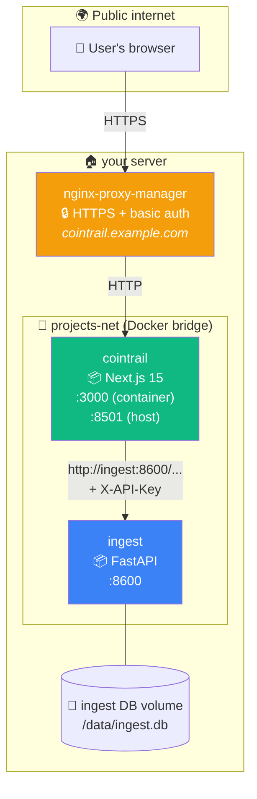

**Key points:**

- Both containers share a Docker network called `projects-net`. That lets Cointrail reach ingest by container name (`http://ingest:8600`) — no DNS, no hairpin routing, no exposed ports.
- **Ingest is not exposed to the internet.** No NPM proxy host for `ingest.example.com` (except the `/sms` endpoint for MacroDroid). Only Cointrail can talk to it.
- Ingest's **DB file lives on a volume** — rebuilds don't wipe data.

---

## 3. The ingest client (`lib/ingest.ts`)

The entire Cointrail → ingest integration is this one tiny file:

```ts
const INGEST_URL = process.env.INGEST_URL || "http://ingest:8600";
const INGEST_API_KEY = process.env.INGEST_API_KEY || "";

export async function ingestFetch(path: string, options?: RequestInit) {
  const headers: Record<string, string> = {
    "Content-Type": "application/json",
    ...((options?.headers as Record<string, string>) || {}),
  };
  if (INGEST_API_KEY) {
    headers["X-API-Key"] = INGEST_API_KEY;
  }
  const res = await fetch(`${INGEST_URL}${path}`, { ...options, headers });
  if (!res.ok) throw new Error(`Ingest API error: ${res.status}`);
  return res.json();
}
```

**What it does:**

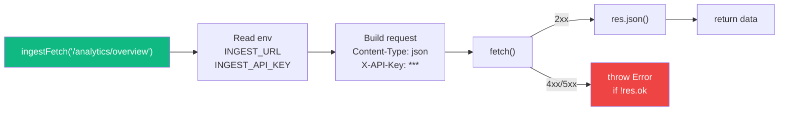

**What it does _not_ do:** retry, rate-limit, cache, batch, or transform. It's a dumb wrapper. Any intelligence lives in the individual API route handlers.

---

## 4. Request lifecycle (single user click)

Here's exactly what happens when you click the **Credit Cards** tab:

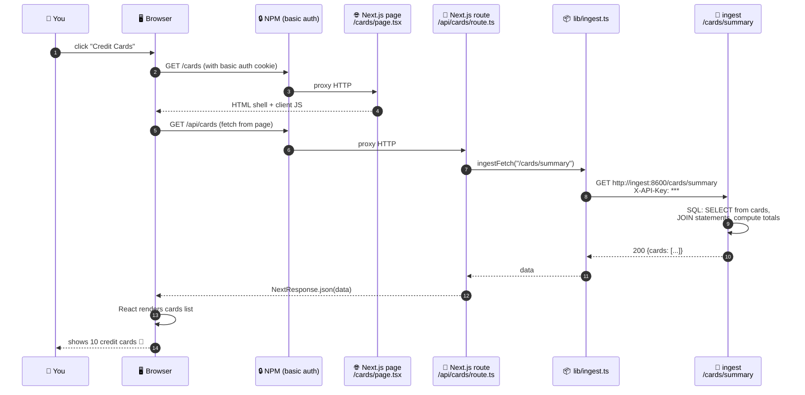

**Note:** The basic auth on step 2/6 is between the browser and NPM — nothing to do with the ingest API key. The ingest API key lives entirely inside the Cointrail container and never touches the browser.

---

## 5. Route-to-route mapping

Cointrail exposes a parallel set of API routes that mirror ingest's. Each Cointrail route is a thin proxy that calls one (or sometimes several) ingest endpoints and forwards the result.

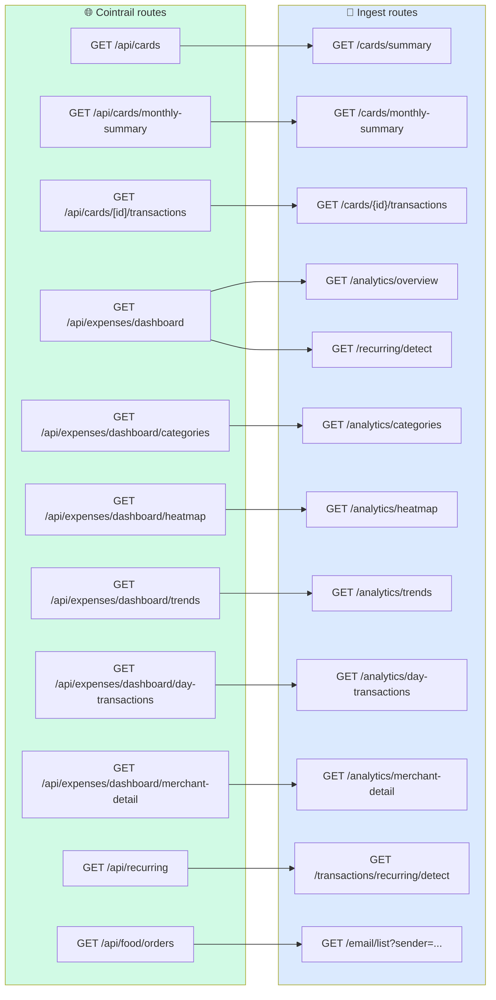

**The odd one out** is `/api/expenses/dashboard` — it calls **two** ingest endpoints in parallel and merges the results:

```ts
// app/api/expenses/dashboard/route.ts
const [overview, recurring] = await Promise.all([
  ingestFetch(`/analytics/overview?period=${period}`),
  ingestFetch("/recurring/detect"),
]);
return NextResponse.json({ overview, recurring });
```

---

## 6. Page → route → ingest map

Which pages hit which endpoints? Here's the breakdown:

```mermaid
flowchart TB
    subgraph Pages["📄 Cointrail pages"]
        H["/"]
        E["/expenses"]
        C["/cards"]
        CD["/cards/[id]"]
        R["/expenses/recurring"]
    end

    subgraph Routes["🔌 Cointrail API routes"]
        D["/api/expenses/dashboard"]
        Cats["/api/expenses/dashboard/categories"]
        HM["/api/expenses/dashboard/heatmap"]
        TR["/api/expenses/dashboard/trends"]
        DT["/api/expenses/dashboard/day-transactions"]
        MD["/api/expenses/dashboard/merchant-detail"]
        CA["/api/cards"]
        CMS["/api/cards/monthly-summary"]
        CT["/api/cards/[id]/transactions"]
        RC["/api/recurring"]
        FO["/api/food/orders"]
    end

    subgraph Ingest["🧠 Ingest endpoints"]
        I_OV["/analytics/overview"]
        I_CAT["/analytics/categories"]
        I_HM["/analytics/heatmap"]
        I_TR["/analytics/trends"]
        I_DT["/analytics/day-transactions"]
        I_MD["/analytics/merchant-detail"]
        I_CS["/cards/summary"]
        I_CMS["/cards/monthly-summary"]
        I_CT["/cards/{id}/transactions"]
        I_RD["/transactions/recurring/detect"]
        I_EL["/email/list"]
    end

    H -.light touch.-> D
    E --> D
    E -->|Overview tab| D
    E -->|Categories tab| Cats
    E -->|Categories drill-down| MD
    E -->|Trends tab| TR
    E -->|Heatmap widget| HM
    E -->|Day panel| DT
    E -->|Food drill-down| FO
    R --> RC
    C --> CA
    C --> CMS
    CD --> CT

    D --> I_OV
    D --> I_RD
    Cats --> I_CAT
    HM --> I_HM
    TR --> I_TR
    DT --> I_DT
    MD --> I_MD
    CA --> I_CS
    CMS --> I_CMS
    CT --> I_CT
    RC --> I_RD
    FO --> I_EL

    style Pages fill:#fef3c7
    style Routes fill:#d1fae5
    style Ingest fill:#dbeafe
```

---

## 7. Authentication at every layer

Three distinct auth mechanisms — don't confuse them:

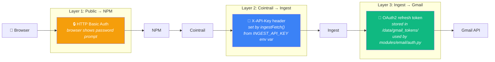

| Layer          | Secret lives in                                                         | Who knows it                        | Expiry                                |
| -------------- | ----------------------------------------------------------------------- | ----------------------------------- | ------------------------------------- |
| NPM basic auth | `npm` container's `/data/access/1`                                      | You | Never                                 |
| Ingest API key | Cointrail's `.env` as `INGEST_API_KEY`, and ingest's `.env` as the same | Server-only, never sent to browser  | Never (rotate manually)               |
| Gmail OAuth    | `/data/gmail_tokens/token.json` (refresh token)                         | Ingest only                         | **Currently expired** — needs re-auth |

---

## 8. Error handling pattern

Every Cointrail route follows the same try/catch shape:

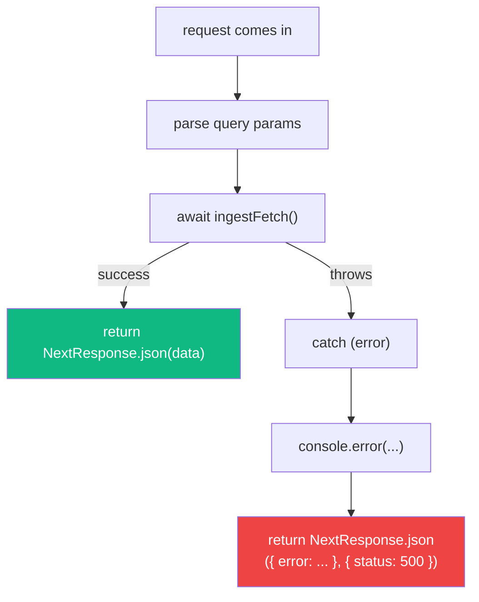

**Some routes return a friendly fallback instead of 500** — e.g. `/api/cards` returns `{ cards: [], error: msg }` so the Credit Cards page shows an empty state instead of a hard crash:

```ts
// app/api/cards/route.ts
try {
  const data = await ingestFetch("/cards/summary");
  return NextResponse.json(data);
} catch (e: any) {
  console.error("Cards fetch failed:", e);
  return NextResponse.json({ cards: [], error: e.message });
}
```

---

## 9. The one "smart" proxy: food orders

Most Cointrail routes are 3-line passthroughs. The exception is `/api/food/orders`, which does real work in the Cointrail layer because ingest's `/email/list` endpoint only returns raw emails — it doesn't parse them into order objects.

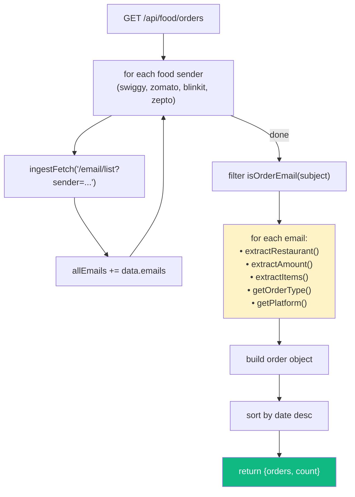

**Why isn't this in ingest?** Historical — the food parser was built in Cointrail first (as a React helper), and later the email pipeline was extracted to ingest. The logic in `lib/food-helpers.ts` never moved. It works fine where it is.

---

## 10. How data freshness works

Cointrail does **not cache** ingest responses. Every page load is a fresh query.

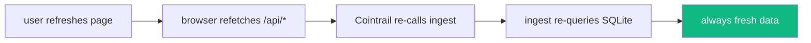

**Why no cache?**

1. SQLite queries on a 10K-row DB are sub-millisecond. Caching would add complexity with no meaningful latency win.
2. Single user — no herd-of-clients to protect the DB from.
3. You _want_ new transactions to show up immediately after the hourly cron runs.

**What about the hourly cron?** Ingest runs its pipeline every hour at `:00`. If you load Cointrail at `:15`, you see everything that was in the DB at `:00` that hour. New SMS pushed by MacroDroid between `:00` and `:15` won't be processed until `:00` next hour (unless you call `POST /cron/trigger` manually).

---

## 11. Environment variables (the knobs)

Cointrail's `.env`:

```
INGEST_URL=http://ingest:8600
INGEST_API_KEY=<same secret as ingest .env>
```

Ingest's `.env`:

```
INGEST_API_KEY=<shared secret>
ALLOWED_ORIGINS=https://cointrail.example.com,http://cointrail:8501
GOOGLE_CLIENT_ID=...
GOOGLE_CLIENT_SECRET=...
```

If either `.env` is missing or the API key doesn't match, every Cointrail page that needs data will render with empty state + a logged error.

---

## 12. Things that look confusing at first

| Thing                                                                                                 | Why it's that way                                                                                                                                                                                                                  |
| ----------------------------------------------------------------------------------------------------- | ---------------------------------------------------------------------------------------------------------------------------------------------------------------------------------------------------------------------------------- |
| **Two sets of dashboard routes** (`/api/expenses/dashboard` and `/api/expenses/dashboard/categories`) | Early routes returned everything in one shot; later iterations split them out when the payload got too big. Both still exist.                                                                                                      |
| **`/api/food/orders` isn't under `/api/expenses`**                                                    | Food used to be its own top-level page before it was merged into the expenses tab. The URL stuck.                                                                                                                                  |
| **Merchant detail endpoint is under `/api/expenses/dashboard`**                                       | It's used exclusively by the Categories drill-down, so it lives with the other dashboard routes.                                                                                                                                   |
| **Some routes don't take a `range` param**                                                            | Ingest exposes most analytics as `?period=YYYY-MM` (single month). Multi-period (3M/6M/1Y) support is partial — the time-range pills in the Overview tab are UI-only for some ranges and the API always returns the current month. |
| **`lib/db.ts` exists in Cointrail**                                                                   | For _manual expense entries only_ — Cointrail keeps its own tiny SQLite (`/data/manual.db`) for expenses the user types directly. All aggregated data still comes from ingest.                                                     |

---

## 13. TL;DR

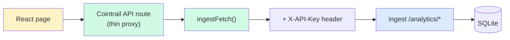

- Browser talks to Cointrail only.
- Cointrail proxies every data query to ingest via `lib/ingest.ts`.
- Ingest queries SQLite and returns JSON.
- No cache, no queue, no fancy retry — just plain HTTP with an API key.

**Under 100 lines of glue code total** (`lib/ingest.ts` + a dozen thin route handlers). All the intelligence lives inside ingest.

---

_Last updated: 2026-04-09 (iteration 26)_
