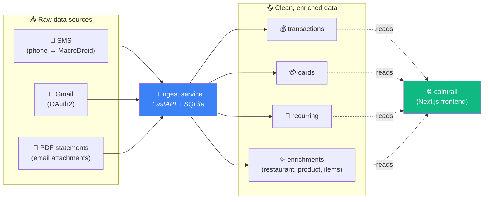
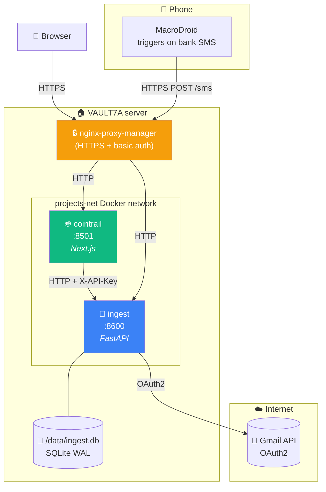
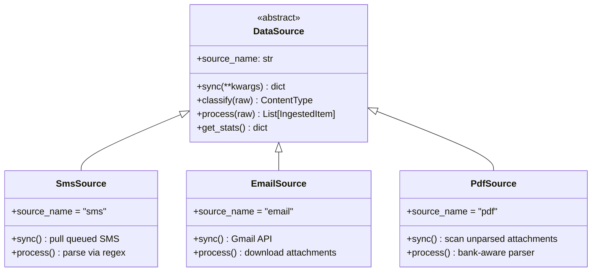
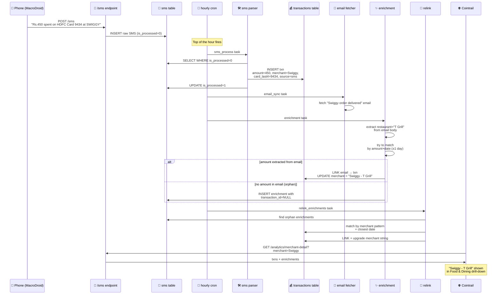
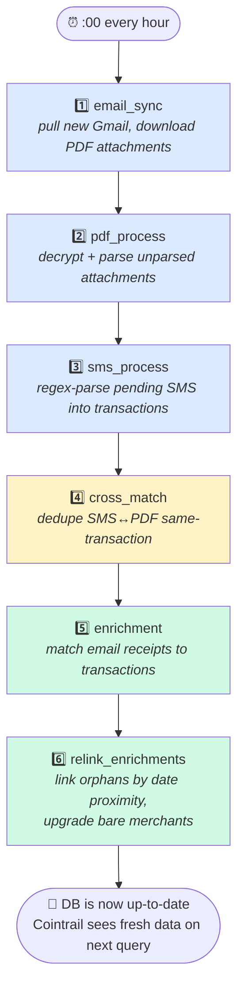
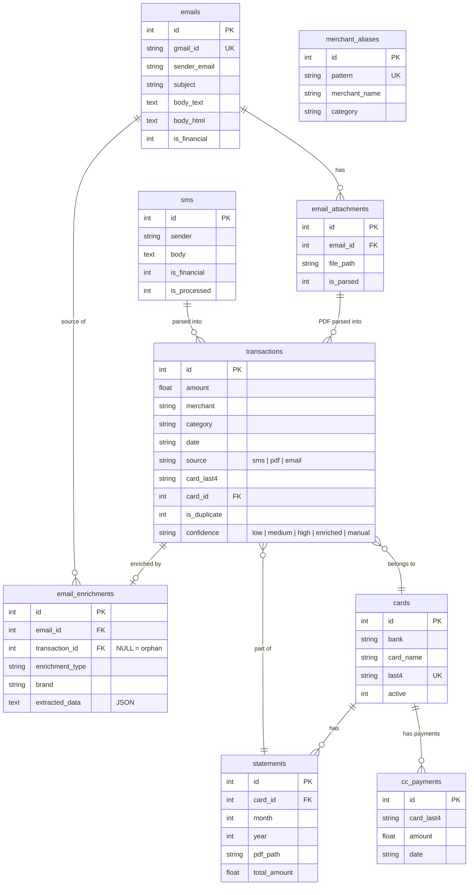
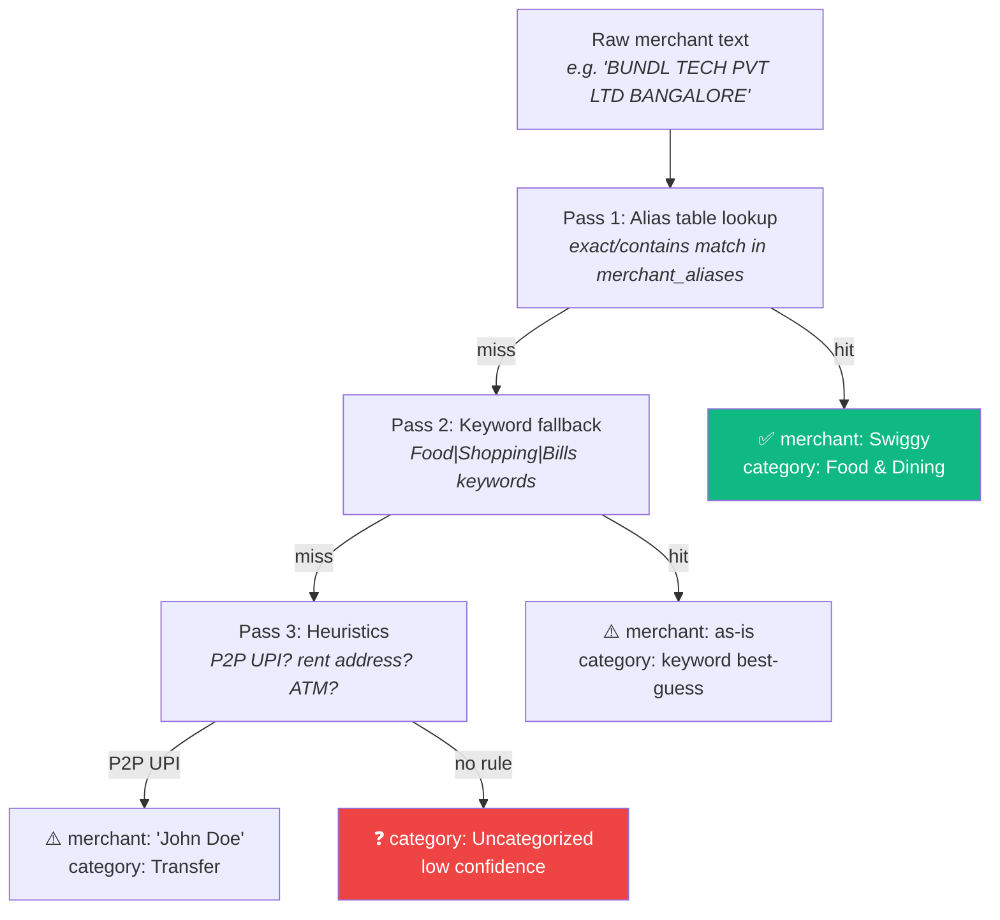
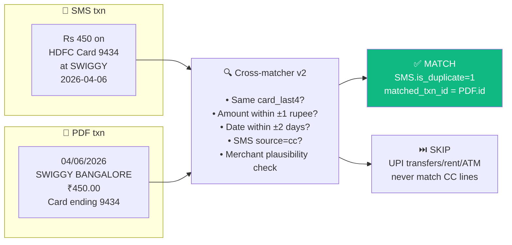
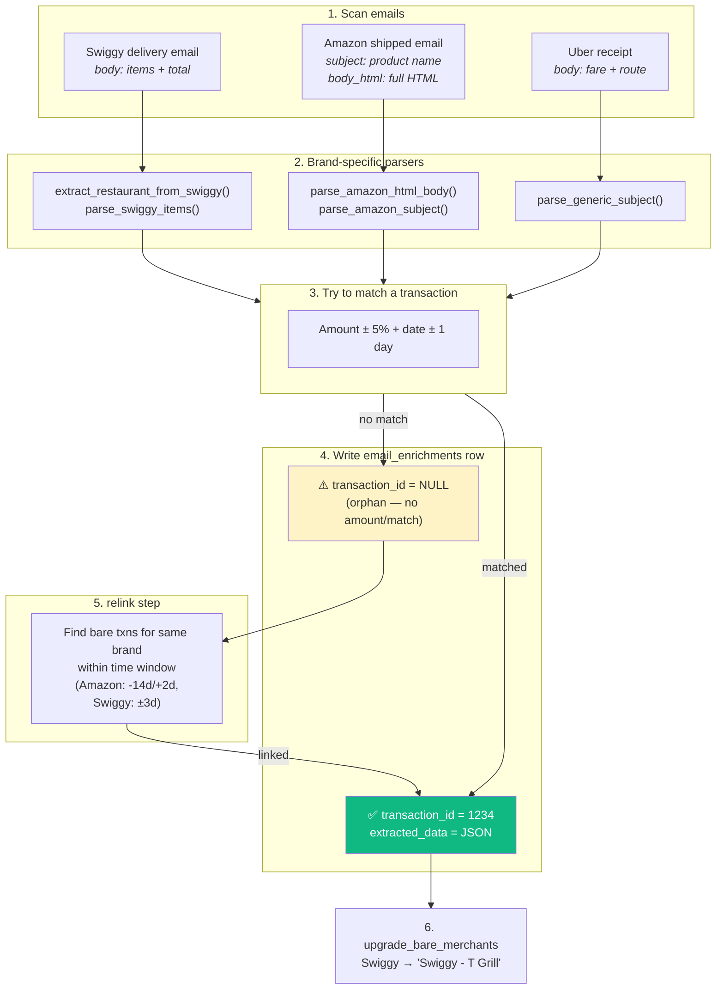

# How Ingest Works

> A visual tour of the personal data ingestion service that powers Cointrail.
> Everything here is diagram-first — read the pictures, the text is just captions.

---

## 1. The 30-second version

**What it does:** Ingest collects raw financial data from three sources (SMS, Gmail, PDF statements), cleans it, deduplicates it, categorizes it, enriches it with merchant/product detail, and exposes it via a FastAPI REST interface that Cointrail queries.

**Where it runs:** Docker container on VAULT7A, port 8600. Single container, single SQLite DB at `/data/ingest.db`.

---

## 2. System layout

**Key points:**
- **One SQLite file** lives on a Docker volume. WAL mode lets multiple readers work concurrently with the single writer.
- **Two Docker containers** on the same network: `ingest` and `cointrail`. They talk to each other by container name, never through the internet.
- **API key authentication** — Cointrail sends `X-API-Key` header on every call. Without it, ingest returns 401.
- **MacroDroid on the phone** POSTs new bank SMS to `/sms` so ingest can process them in near-realtime.

---

## 3. The three data sources

Every source implements the same `DataSource` abstract interface — that's how ingest stays future-proof (Telegram, push notifications, etc. can be added the same way).

Each source produces `IngestedItem` objects with a shared schema (amount, merchant, date, card_last4, bank, txn_type, confidence) that get written to the `transactions` table.

---

## 4. How a transaction travels through the pipeline

This is the journey of a single ₹450 Swiggy order from your phone to the Categories drill-down in Cointrail.

---

## 5. The hourly pipeline (cron)

Every hour at :00 the ingest service enqueues 6 tasks to its background queue. They run sequentially, each depending on the previous step.

**Why the order matters:** Each step needs the previous one to have finished. PDFs can only be parsed after they've been downloaded (step 1). SMS and PDF can only be cross-matched after both have been parsed (steps 2+3). Enrichment only finds transactions to link to after they exist. Relinking only helps after enrichment has created the orphan enrichments.

You can trigger the full pipeline manually with `POST /cron/trigger`.

---

## 6. Database schema (the important tables)

**The `transactions` table is the centre of gravity.** Everything else either feeds into it (SMS, emails, PDFs) or annotates it (enrichments, aliases, cards, statements).

---

## 7. Classification flow (which category does a transaction belong to?)

When a raw SMS or PDF line becomes a transaction, it runs through a 3-pass categorizer:

**The alias table is seeded with 200+ merchant patterns** (`"bundl technologies"` → Swiggy, `"amzn mktplc"` → Amazon, etc.) and grows over time. When you recategorize a transaction in Cointrail, the override gets stored so it sticks.

---

## 8. Cross-matching (SMS ↔ PDF deduplication)

A single credit card swipe typically shows up **twice**: once as an instant SMS alert and once as a line on the monthly PDF statement. Cross-matcher finds these pairs and marks one as a duplicate.

**Conservative rules:** Only SMS with `source="cc"` and non-NONCC categories can match PDF lines. Zero false duplicates in production today.

---

## 9. The enrichment system (where "Swiggy" becomes "Swiggy - T Grill")

Enrichment is a parallel layer that scans financial emails (Swiggy, Amazon, Uber, Zomato, BookMyShow, etc.) and extracts structured details (restaurant names, product names, item lists) that get attached to matching transactions.

**Why the relink step exists:** Many email receipts don't contain the transaction amount (especially "delivered" notifications), so the original amount-matcher can't link them. The relink step matches by **brand + date proximity** instead, with asymmetric windows per brand (Amazon "delivered" emails arrive up to 14 days after the charge, so it searches mostly backwards).

**Current coverage (April 2026):**
| Category | Before relink | After relink |
|---|---|---|
| Food & Dining | 25% | **36%** |
| Shopping (Amazon) | 1% | **25%** |

---

## 10. Complete route map

All endpoints the ingest service exposes (every non-public route requires `X-API-Key`):

| Prefix | Route | Purpose |
|---|---|---|
| `/health` | GET | Liveness probe (public, no auth) |
| `/sms` | POST, /parse, /process-pending, /import/xml | Receive & parse SMS |
| `/email` | /sync, /status, /auth, /list | Gmail sync + query |
| `/pdf` | /upload, /parse-path, /process-all, /process-unparsed, /status | PDF statement pipeline |
| `/cards` | /, /summary, /{id}/statements, /{id}/transactions, /monthly-summary, /statements/backfill, /payments/backfill | Credit card queries |
| `/transactions` | GET, PUT {id}, /recategorize-all, /recurring/detect | Transaction CRUD |
| `/analytics` | /overview, /categories, /trends, /heatmap, /day-transactions, /merchant-detail | Dashboard queries |
| `/content` | / | Unified content query (future) |
| `/tasks` | / | Background queue status |
| `/cron` | /trigger, /status | Manual cron trigger |
| `/system` | /health, /stats, /cross-match, /aliases, /categories, /analysis/*, /enrichments, /upi/* | Admin operations |

---

## 11. Why it's built this way

| Design choice | Reason |
|---|---|
| **SQLite, not Postgres** | Single-user service, ~10K transactions. WAL mode handles concurrent readers. Zero operational cost. |
| **FastAPI, not Django/Flask** | Async-friendly, automatic OpenAPI docs at `/docs`, minimal boilerplate. |
| **In-process task queue (no Celery/Redis)** | Single container, single user — an external broker would be overkill. SQLite-backed queue is good enough and survives restarts. |
| **`DataSource` abstract base** | Adding a new source (Telegram bot, push notifications) means implementing one class, not rewriting the pipeline. |
| **API key auth, not OAuth** | Cointrail is the only client. One static secret in `.env` is simpler and auditable. |
| **Volume-mounted DB** | Lets you `docker compose up --build` safely without losing data. Also lets scripts hot-read the DB for debugging. |
| **Hourly cron instead of event-driven** | Debounces API rate limits (Gmail, MacroDroid) and keeps the system calm. Financial data rarely needs sub-hour latency. |

---

## 12. Quick glossary

| Term | Meaning |
|---|---|
| **Source** | Where raw data comes from: `sms`, `email`, or `pdf`. |
| **Transaction** | A single financial event (debit or credit). |
| **Cross-match** | Deduplication between SMS alerts and PDF statement lines for the same physical swipe. |
| **Enrichment** | Attaching structured metadata (restaurant, product, items) to a transaction from a matching receipt email. |
| **Relink** | Second-pass matcher that links orphan enrichments to bare transactions by brand + date proximity. |
| **Confidence** | How sure ingest is about a transaction's category: `low` → `medium` → `high` → `enriched` → `manual` (user override). |
| **Alias** | A merchant name pattern that maps a raw bank description to a clean merchant + category. |
| **Orphan enrichment** | An email enrichment that exists but isn't linked to any transaction (usually because the email didn't include an amount). |

---

*Last updated: 2026-04-09 (iteration 26)*
